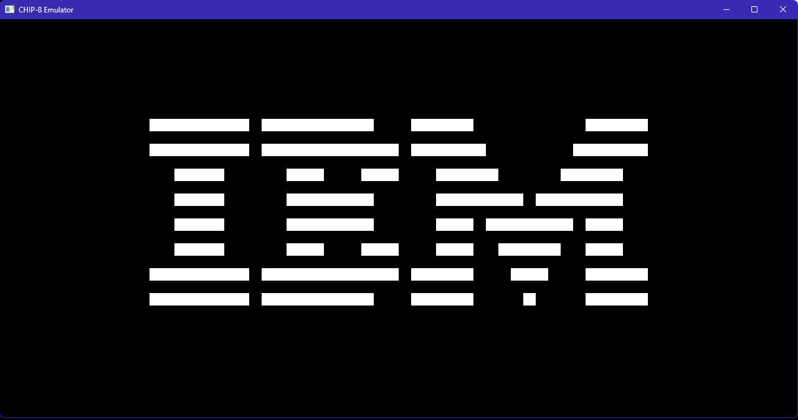
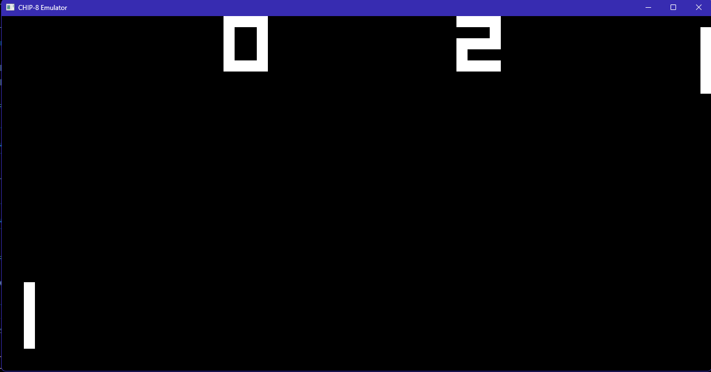

<p align="center">
  
  
</p>

# CHIP-8 in Elyra

A CHIP-8 interpreter written in [Elyra](https://github.com/vbxq/elyra), with a typed CPU state, packed byte memory and framebuffer, and SDL2 graphics, keyboard input and sound through the C FFI.

## Run

Requires Elyra 0.22.0 and the system SDL2 library. No native wrapper module or Rust build is needed in this project.

```bash
cd ~/sources/chip8-aelys
elyra main.elyra path/to/game.ch8
```

Without a ROM argument, it loads `rom.ch8` next to `main.elyra`. ROMs are not bundled. Relative ROM paths are resolved from your current directory. Empty ROMs and ROMs larger than 3584 bytes are rejected.

The default CPU speed is 600 Hz. Timers and presentation run at 60 Hz independently of CPU speed. Escape quits.

```bash
elyra main.elyra game.ch8 --scale 16 --hz 700
elyra main.elyra game.ch8 --mute
elyra main.elyra --usage
```

`--scale` accepts 1–40; `--hz` accepts 1–100000. `--frames N` closes after N presentation ticks. `--screenshot image.pgm` saves the final 64×32 framebuffer as a binary grayscale PGM.

For a deterministic run without a window or sound:

```bash
elyra main.elyra game.ch8 --headless --cycles 10000 --screenshot image.pgm
```

The JIT is optional: add `-ae.jit=on` to the Elyra command. The old capability flags and bundled OpenGL binaries are no longer used.

## Keypad

```
CHIP-8       Keyboard
1 2 3 C      1 2 3 4
4 5 6 D      Q W E R
7 8 9 E      A S D F
A 0 B F      Z X C V
```

Keys are released when the window loses focus. The sound timer plays a 440 Hz tone; use `--mute` if no audio device is available.

## Compatibility

This keeps the original emulator's profile: shifts use VX, FX55/FX65 leave I unchanged, BNNN adds V0, sprites clip at the screen edges, logic operations preserve VF, and FX0A accepts a held key. Legacy 0NNN system calls are ignored. It implements classic 64×32 CHIP-8, without SUPER-CHIP or XO-CHIP extensions.

Invalid instructions, out-of-range instruction/data accesses and stack overflow/underflow produce an error instead of a VM bounds exception.

## Tests

```bash
python3 tests/run.py
```

Runs CPU regressions, 300 generated cases checked against an independent Python arithmetic/state oracle, and SDL pixel/key/audio/quit checks, with interpretation, synchronous JIT and asynchronous JIT plus GC stress/verification. SDL tests use its dummy video/audio drivers. The same command checks ROM/argument errors, headless execution, exact screenshot bytes and compiled bytecode execution.

The optional X11 integration test requires a display and `xdotool`. It sends a real Q keypress to the window and checks the exact resulting CHIP-8 glyph and Escape exit:

```bash
python3 tests/interactive.py
```

Both test commands accept `--elyra /path/to/elyra`.
